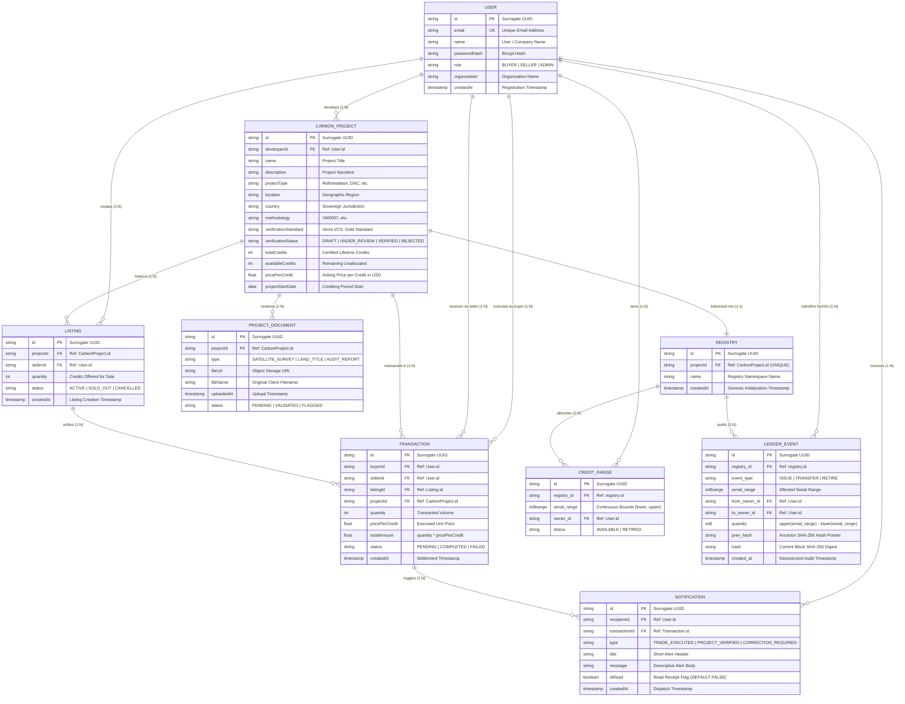

# Carbex Complete & Correct Entity-Relationship (ER) Diagram

This diagram represents the complete hybrid architecture of Carbex, including:
1. **Prisma Application Layer:** User management, Carbon Projects, Document Auditing, Listings, and Transactions.
2. **Real-Time Notification Layer:** Asynchronous Seller & Buyer alert dispatches.
3. **PostgreSQL Cryptographic Range Ledger:** Namespace Registries, `int8range` custody allocations (guarded by GiST exclusion constraints), and Append-Only SHA-256 Hash Chain logs.

---

## 1. Relational ER Diagram (Crow's Foot Notation)



---

## 2. Conceptual Chen Notation (Hand-Drawn Academic Layout)

For your handwritten record sheet, use this exact structural schema:

```
[ ENTITY ] = Rectangle
< RELATIONSHIP > = Diamond
( Attribute ) = Oval
(( Multivalued Attribute )) = Double Oval
( Derived Attribute ) = Dashed Oval
_Attribute_ = Underlined Primary Key

                 (name)      (_id_)       (email)
                   \           |           /
                 +---------------------------+
                 |           USER            |
                 +---------------------------+
                   | 1                   | 1
                   |                     |
             < Develops >           < Alerts >
                   | N                   | N
                   v                     v
+-----------------------------+   +-----------------------------+
|       CARBON_PROJECT        |   |        NOTIFICATION         |
| _id_, name, country, status |   | _id_, title, message, isRead|
+-----------------------------+   +-----------------------------+
   | 1             | 1                          ^
   |               |                            | N
< Tokenizes >  < Contains >                < Triggers >
   | 1             | N                          | 1
   v               v                            |
+----------+   +------------------+   +--------------------+
| REGISTRY |   | PROJECT_DOCUMENT |   |    TRANSACTION     |
| _id_     |   | _id_, type, url  |   | _id_, qty, (total) |
+----------+   +------------------+   +--------------------+
   | 1                                          ^
   +---------------+                            |
   | 1             | 1                          | M
< Allocates >   < Audits >                 < Settles >
   | N             | N                          | 1
   v               v                            v
+--------------+ +--------------+       +------------------+
| CREDIT_RANGE | | LEDGER_EVENT |       |     LISTING      |
| _id_, serial | | _id_, hash   |       | _id_, quantity   |
+--------------+ +--------------+       +------------------+
```

---

## 3. Structural Constraints Summary Table

| Relationship | Entities Involved | Cardinality Ratio | Participation Constraint | Description |
| :--- | :--- | :---: | :---: | :--- |
| **Develops** | `User` $\to$ `CarbonProject` | $1:N$ | Partial for `User`, **Total** for `CarbonProject` | A Seller can develop multiple projects; each project must have a developer. |
| **Contains** | `CarbonProject` $\to$ `ProjectDocument` | $1:N$ | Partial for `CarbonProject`, **Total** for `ProjectDocument` | A project contains documents; documents cannot exist without a parent project (`CASCADE`). |
| **Tokenizes** | `CarbonProject` $\to$ `registry` | $1:1$ | **Total** for `CarbonProject`, **Total** for `registry` | Each verified project creates exactly one cryptographic ledger namespace. |
| **Allocates** | `registry` $\to$ `credit_range` | $1:N$ | **Total** for `registry`, **Total** for `credit_range` | A registry allocates its credit volume into discrete, non-overlapping serial intervals. |
| **Owns** | `User` $\to$ `credit_range` | $1:N$ | Partial for `User`, **Total** for `credit_range` | A user can hold zero or many ranges; each credit range must have an owner. |
| **Audits** | `registry` $\to$ `ledger_event` | $1:N$ | **Total** for `registry`, **Total** for `ledger_event` | Every event belongs to a registry and cannot be modified (Append-Only). |
| **Lists** | `CarbonProject` $\to$ `Listing` | $1:N$ | Partial for `CarbonProject`, **Total** for `Listing` | Projects are listed on the open marketplace with a specific quantity. |
| **Settles** | `Listing` $\to$ `Transaction` | $1:N$ | Partial for `Listing`, Partial for `Transaction` | Market listings are fulfilled by buyer purchase transactions. |
| **Triggers** | `Transaction` $\to$ `Notification` | $1:N$ | Partial for `Transaction`, **Total** for `Notification` | Executed transactions fire database triggers to alert the project developer. |
| **Alerts** | `User` $\to$ `Notification` | $1:N$ | Partial for `User`, **Total** for `Notification` | Alerts are directed to a recipient user. |
