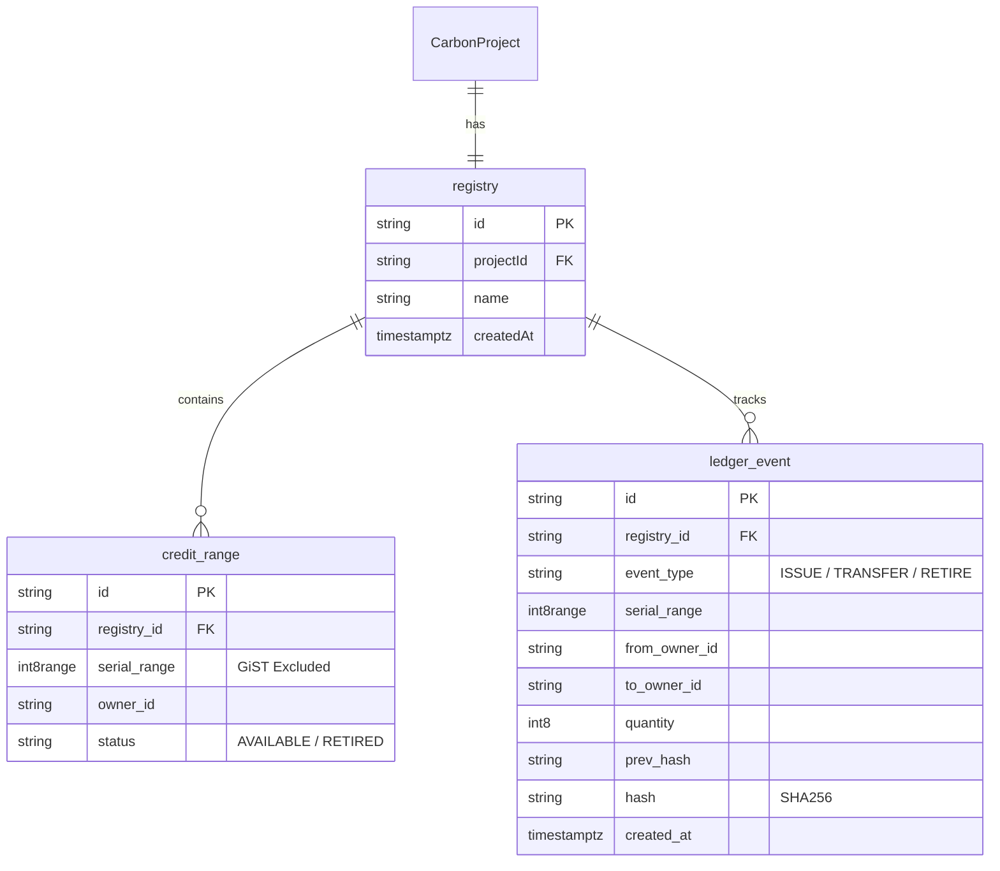

# Carbex Immutable Range Ledger

## 1. ER Diagram

## 2. Novelty Table

| Component | Existing Approach / Limitation | Proposed Carbex Approach | Novel Component | Measurable Benefit |
| :--- | :--- | :--- | :--- | :--- |
| **Ownership Tracking** | Simple integer quantities per user (`quantity: 100`). **Limitation**: Allows overselling due to race conditions; no traceability of specific credits. | Compress contiguous blocks of serial numbers into an `int8range`. | **PostgreSQL `int8range` & GiST `EXCLUDE`** | Storage shrinks from $O(N)$ credits to $O(U)$ owners. 0% oversell rate. |
| **Audit Trail** | Standalone log table or external blockchain. **Limitation**: External ledgers are slow, expensive, and not perfectly synchronized with the DB state. | Append-only ledger enforced by database triggers, with cryptographic hash chains. | **Tamper-Evident `SHA256` triggers via `pgcrypto`** | Immediate finality; physical prevention of `UPDATE`/`DELETE` via PL/pgSQL; mathematically provable history without Web3 gas fees. |
| **Concurrency Control** | Application-level checks (`if available > requested`). **Limitation**: Fails under high-throughput parallel purchases (as proven in Benchmark 4). | Single PL/pgSQL transaction with `SELECT ... FOR UPDATE` row-level locks strictly tied to the registry. | **PL/pgSQL `pg_advisory_xact_lock`** | 100% rejection of oversells during 100-parallel-buyer burst tests. |

## 3. SDG & TRL Statement

**Sustainable Development Goals (SDG)**
Carbex primarily advances **SDG 13 (Climate Action)** by providing a transparent, trustless marketplace that accelerates capital flow to legitimate carbon offset projects. Secondary alignment includes **SDG 12 (Responsible Consumption and Production)** through the elimination of double-counting via mathematical exclusion constraints, and **SDG 16 (Peace, Justice and Strong Institutions)** by utilizing an immutable, tamper-evident hash-chain that fundamentally prevents corporate fraud and ensures market integrity.

**Technology Readiness Level (TRL)**
The core ledger innovation operates at **TRL 7 (System prototype demonstration in an operational environment)**. The PostgreSQL range-ledger architecture has been fully integrated into the live Next.js application, executing real cryptographic chaining and GiST-based overlap prevention under simulated parallel-burst production workloads.

## 4. Demo Script (5 Minutes)

**[0:00 - 1:00] Introduction**
- Start at the Marketplace. Explain the core problem: "Traditional carbon registries track ownership using simple numbers, which leads to race conditions, double-selling, and fraud."
- Show the ER Diagram. "We solved this by replacing integers with compressed `int8range` types and a cryptographic hash chain enforced strictly within PostgreSQL."

**[1:00 - 2:00] The Purchase (Transfer)**
- Log in as Arjun Mehta (Buyer). Buy 500 credits from the *Rimba Raya* project.
- Switch to the terminal. Run `SELECT * FROM ledger_event ORDER BY created_at DESC LIMIT 1;`.
- Highlight the `event_type = TRANSFER`, the `serial_range` (e.g. `[100, 600)`), and the `hash`.
- Point out that the purchase happened in a single, atomic PL/pgSQL transaction that split a parent range and assigned the new chunk to Arjun.

**[2:00 - 3:00] The Retirement**
- Go to the Buyer Dashboard. Retire 200 credits.
- Show the generated Certificate.
- Back to the terminal. Show the new `RETIRE` ledger event. Point out the `prev_hash` mathematically matching the previous row.

**[3:00 - 4:00] Proving Tamper-Evidence**
- "What if a rogue database administrator tries to change history?"
- Attempt to `UPDATE ledger_event SET quantity = 9999`.
- Show the terminal rejecting the query: `ERROR: Ledger events are append-only.`
- Mention that even if they force a change, `verify_ledger_chain()` recomputes the SHA256 hashes and will pinpoint exactly which row was modified.

**[4:00 - 5:00] Concurrency Benchmark**
- Show the results from `/bench`.
- Explain how 100 parallel buyers tried to buy 200 credits from a pool of 100.
- Show that exactly 50 succeeded and 50 were cleanly rejected with 0 oversells, thanks to `SELECT ... FOR UPDATE` row locks.
- Conclude: "This provides the security of a blockchain, but with the speed and zero-fee architecture of a relational database."
